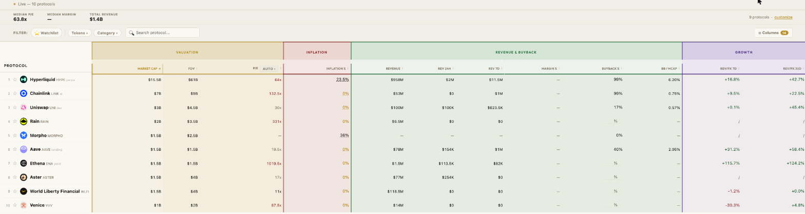
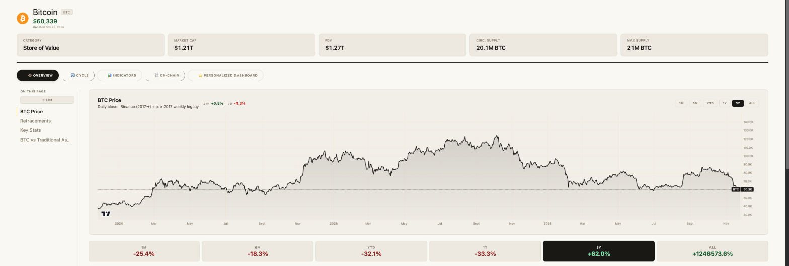

# Crypto Floor

Fundamental analysis for crypto protocols, built and run by me.
Live at **[app.mattiasera.com](https://app.mattiasera.com)**.

The idea is simple: treat a protocol like a company.
Look at revenue, fees, buybacks, dilution and valuation multiples, then compare the price to what the business earns.

This repo is a showcase. The production code is private.



## What it calculates

**Protocol screener**
- Valuation: market cap, FDV, price to earnings
- Dilution: yearly token inflation
- Revenue: last 24h, 7 days and full year
- Buybacks: share of revenue used for buybacks, and buybacks as a share of market cap
- Growth: revenue against price over 7 and 30 days

**Bitcoin**
- Price history, drawdowns from the high, cycle overlays
- Market indicators: Fear & Greed, time above and below moving averages, realized vs implied volatility, DVOL, price momentum, options skew, spot volume and spot CVD
- On-chain: MVRV with history back to 2010
- Whale vs retail positioning on futures, collected every day (the exchange only keeps 30 days, so the history exists only because the job runs daily)
- ETF flows

**Macro and flows**
- Macro page and capital flows between chains



## How the data flows

```
Public APIs  ->  Python pipeline  ->  Database  ->  Cloud storage  ->  API  ->  Web app
(DefiLlama,      (fetch, clean,       (snapshot +    (fast reads,       (access    (one-page
 CoinGecko,       compute metrics)     time series)   no egress cost)    checks)     dashboard)
 exchanges,
 on-chain data)
```

1. **Fetch** - a Python pipeline pulls data from DefiLlama, CoinGecko, exchange APIs and on-chain sources, then computes the metrics.
2. **Store** - results go to a Postgres database (Supabase): one current snapshot per protocol, plus a time series for each one.
3. **Publish** - the data is exported to cloud storage (Cloudflare R2), so the site never reads the database directly.
4. **Serve** - serverless functions on Vercel read the files and serve the web app.

## How it runs

- A daily job refreshes every protocol and indicator
- Prices refresh every few hours
- A watchdog sends an alert if the data gets stale
- External data enters only through the pipeline, never straight from the browser

## Stack

Python, SQL (Postgres / Supabase), Cloudflare R2, Vercel serverless functions, JavaScript, GitHub Actions and scheduled local jobs.

## About me

Investment analyst covering stocks and crypto.
I value companies and protocols from their financials and build my own data tools to do it.

- Portfolio: [public work on Google Drive](https://drive.google.com/drive/folders/1YJTW5JQL8dBAFJTFq1HD_qbiFeyv2KS1)
- Website: [mattiasera.com](https://mattiasera.com)
